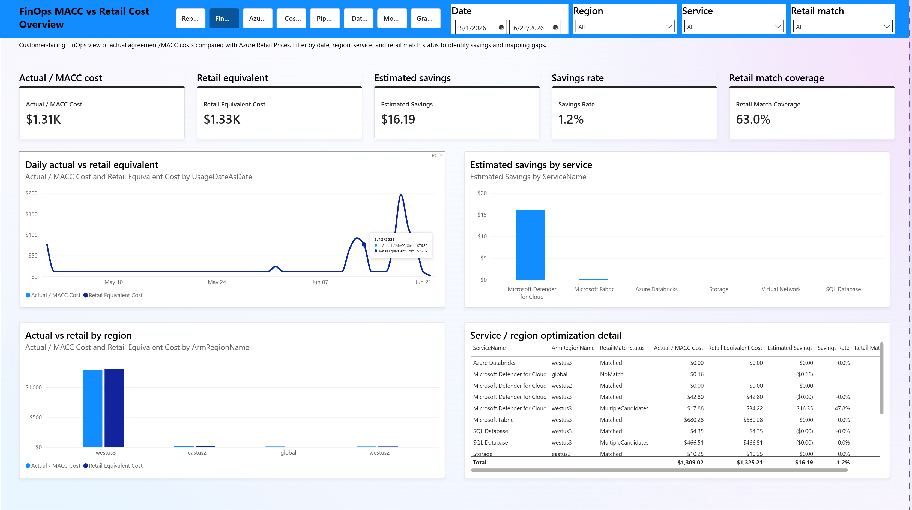
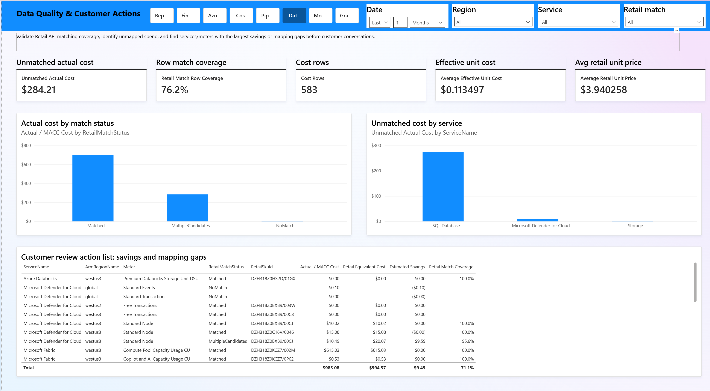
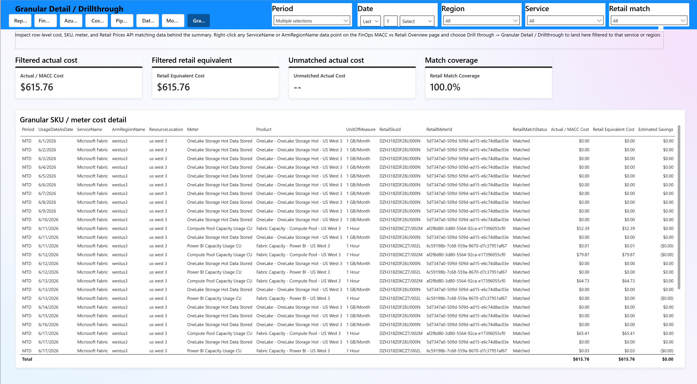

# FinOps MACC vs Retail Report — Pages Preview

This guide provides visual previews of the key report pages you will encounter when using the FinOps MACC vs Retail Report.

---

## Overview Page

The **Overview** page is the primary dashboard for comparing actual Azure costs against estimated Pay-As-You-Go retail equivalent. This page provides high-level cost analysis, service breakdowns, and regional distributions to help you quantify directional savings and identify cost drivers.

**Key Features:**
- Executive-level cost comparison visuals
- Service and region-based cost breakdowns
- Key performance indicators for savings quantification
- Trend analysis across selected date ranges
- Right-click drillthrough capability to the Granular Detail page for deeper investigation

---

## Cost Export Validation Page

The **Cost Export Validation** page ensures data quality and completeness of cost and retail pricing data flowing through the ingestion pipeline. This page displays summary statistics, row counts, and data freshness indicators.

**Key Features:**
- Cost data summary tables by service and resource group
- Retail pricing snapshot metrics
- Data freshness and completeness checks
- Pipeline validation status indicators
- Identifies missing or incomplete cost records for investigation

---

## Granular Detail / Drillthrough Page

The **Granular Detail** page is a context-sensitive view accessed via right-click drillthrough from the Overview page. It displays detailed cost records filtered by the selected service and region, allowing you to investigate specific cost drivers.

**Key Features:**
- Detailed cost records filtered by service and ARM region
- Line-item cost and retail price comparison
- Retail match status and SKU mapping information
- Meter-level granularity for precise cost attribution
- Context-aware filtering based on Overview page selection

---

## Additional Report Pages

In addition to the pages shown above, the report includes:

### Report Landing Page
- Executive summary of report purpose and design questions
- Stacked navigation menu for easy access to all report sections
- Introduction and disclaimer information

### Azure Retail Reference Page
- Full Pay-As-You-Go pricing catalog snapshot
- Service, SKU, and meter-level pricing details
- Currency and effective date information

### Pipeline Diagnostics Page
- Detailed tables showing each stage of the cost and retail data pipeline
- MTD (Month-To-Date) and Last-Month snapshots
- Raw, normalized, and enriched data representations

### Data Quality Actions Page
- Data quality metrics and issue tracking
- Recommendations for addressing data gaps
- Links to remediation workflows

### Model Technical Tables Page
- Internal date table documentation
- Technical schema reference information
- Model completeness verification

---

## Navigation

All report pages include a **Navigation Bar** in the top-right corner that allows you to jump between any of the main report pages. The Landing page provides a structured Table of Contents with all navigation options stacked vertically for easy browsing.

**Drillthrough pages** (like Granular Detail) are accessed via right-click context menus on data visualizations and remain hidden from the standard page navigation to maintain focus on the primary analysis flow.

---

## Getting Started

1. **Start at the Landing Page** — Review the executive summary and familiarize yourself with the report structure
2. **Navigate to Overview** — Explore costs and identify areas of interest using the main dashboards
3. **Drill Deeper** — Right-click on specific service or region values to access the Granular Detail page
4. **Validate Data Quality** — Check the Cost Export Validation page to ensure you're working with complete data
5. **Reference External Data** — Consult the Azure Retail Reference page to understand pricing structures

---

## Tips for Effective Use

- **Use filters** on the Overview page to focus on specific subscriptions, time periods, or service categories
- **Right-click visualizations** to access drillthrough capabilities when you need granular detail
- **Check validation metrics** regularly to catch any data pipeline issues early
- **Reference the Azure Retail snapshot** when comparing MACC vs. Pay-Go to understand regional and meter-level pricing variations
- **Review the technical tables** if you need to understand model lineage or date dimension structures
